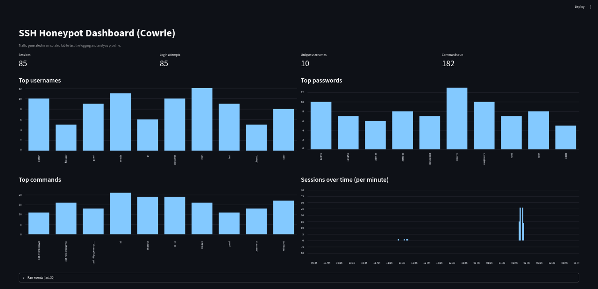

# SSH Honeypot Lab (Cowrie + Docker + Python)

A small defensive-security lab that deploys an SSH honeypot, records everything an "attacker" does inside a fake shell, and turns the raw logs into statistics and a dashboard.

> **Note:** All traffic in this project was generated by me inside an isolated lab VM to test the logging and analysis pipeline. The honeypot was never exposed to the internet, and no real attacker data is shown.



## What it does

- Runs [Cowrie](https://github.com/cowrie/cowrie), a medium-interaction SSH honeypot, in Docker.
- Logs login attempts (usernames and passwords) and the commands run inside the fake shell as JSON.
- Parses the logs with Python and reports sessions, top usernames, passwords and commands.
- Visualizes the results in a Streamlit dashboard.

## Architecture

```
Simulated client --SSH:2222--> Cowrie (Docker) --> logs/cowrie.json --> analyze.py --> Streamlit dashboard
```

## Tech stack

Kali Linux (VMware) · Docker Compose · Cowrie · Python · Streamlit · pandas

## Project structure

```
.
├── docker-compose.yml     # Cowrie container, port 2222, log volume
├── analyzer/analyze.py    # CLI log analysis
├── dashboard/app.py       # Streamlit dashboard
├── tools/simulate.sh      # Lab traffic generator (local honeypot only)
├── docs/screenshots/      # Dashboard screenshot
└── requirements.txt
```

## Getting started

```bash
# 1. Start the honeypot
docker compose up -d

# 2. Generate lab traffic (requires sshpass)
sudo apt install sshpass -y
bash tools/simulate.sh

# 3. Analyze from the terminal
python3 analyzer/analyze.py

# 4. Launch the dashboard
python3 -m venv .venv && source .venv/bin/activate
pip install -r requirements.txt
streamlit run dashboard/app.py
```

## Sample results (lab-generated data)

| Metric | Value |
|---|---|
| Sessions | 85 |
| Login attempts | 85 |
| Unique usernames | 10 |
| Commands run | 182 |

## What I learned

- How an SSH honeypot emulates a Linux shell and what it records.
- Structure of Cowrie's JSON events (`cowrie.session.connect`, `cowrie.login.success`, `cowrie.command.input`).
- Why data cleaning matters: key-auth events skewed the first password counts, and chained commands had to be split to count each one.
- Deploying a service with Docker Compose and troubleshooting container networking.

## Possible improvements

- Ship logs to Elasticsearch/Kibana or Splunk.
- Add GeoIP enrichment and alerting rules.
- Run on an isolated cloud VM to capture real-world attack traffic.

## Disclaimer

For educational and defensive purposes only. Run it in an isolated environment.
